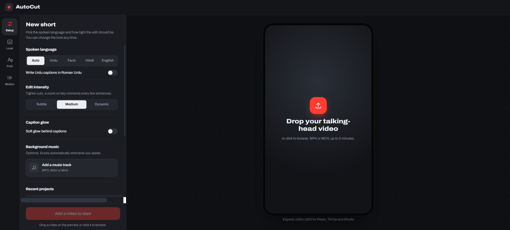
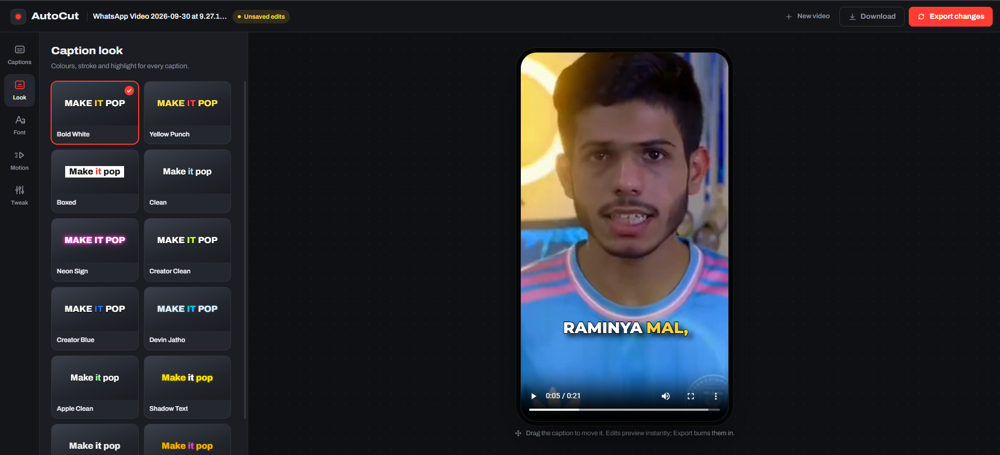
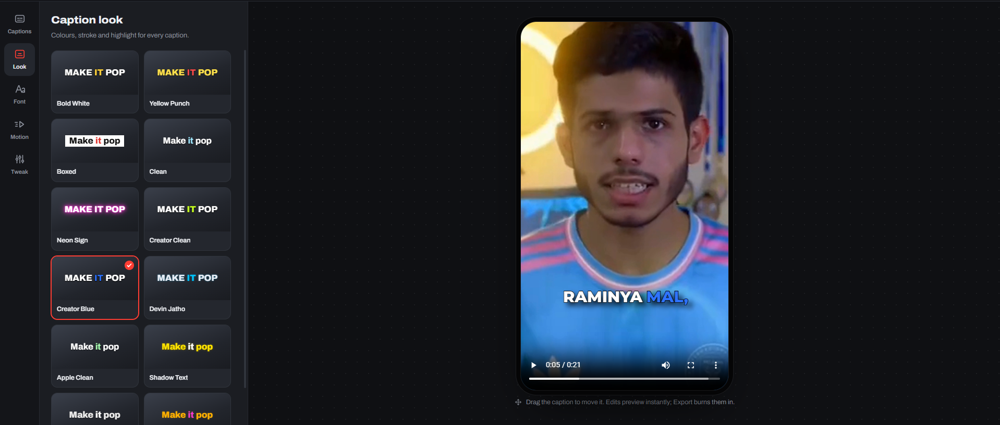
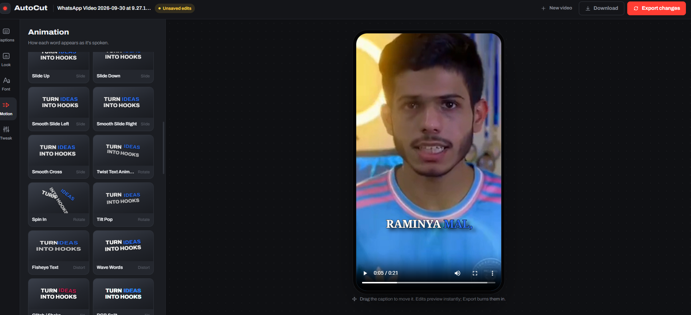
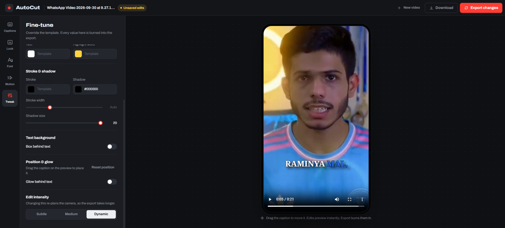
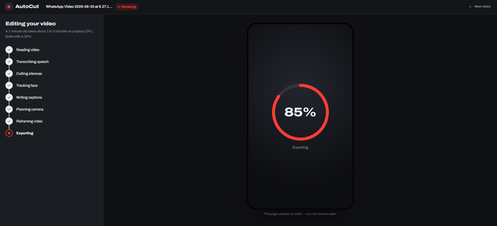

# 🎬 Caption Flow

### AI-Powered Video Captioning & Creative Text Effects Editor

Caption Flow is a web-based video editing application that helps users generate captions, apply creative text animations, and export edited videos. It combines automatic captioning with stylish text effects to make videos more engaging.

🌐 **Live Website:** [Open Caption Flow](https://caption-flow-frontend.vercel.app/)

---

## ✨ Features

- 🎙️ Automatic video caption generation
- 💬 Caption styling and animated subtitles
- ✨ Creative text animations and visual effects
- 🌟 Glow and 3D-style text effects
- 🧱 Wall-style text effects
- 🎞️ Video processing and export
- 📄 Subtitle file generation
- 🖥️ Web-based editing interface

---

## 🖼️ Website Screenshots

### 1. Home Page



### 2. Video Editor



### 3. Text Effects



### 4. Creative Effect — Demo Screenshot 1



### 5. Creative Effect — Demo Screenshot 2



### 6. Creative Effect — Demo Screenshot 3



---

## 🎥 Edited Video Demonstrations

Explore the sample videos created with Caption Flow.

### ▶ Demo 1

[**Watch or open Demo 1**](docs/demos/demo1.mp4)

### ▶ Demo 2

[**Watch or open Demo 2**](docs/demos/demo2.mp4)

### ▶ Demo 3

[**Watch or open Demo 3**](docs/demos/demo3.mp4)

### ▶ Demo 4

[**Watch or open Demo 4**](docs/demos/demo4.mp4)

---

## 🛠️ Technology Stack

### Frontend
- React
- Vite
- JavaScript
- CSS

### Backend
- Python
- FastAPI
- FFmpeg

---

## 🌐 Deployment & Backend Availability

The frontend is deployed on **Vercel**, while the backend currently runs locally on the developer's laptop.

To make the locally running backend accessible to the deployed frontend, this project uses a **Cloudflare Quick Tunnel**.

### How the current setup works

1. The frontend website is hosted on Vercel.
2. The Python FastAPI backend runs on the developer's laptop.
3. Cloudflare Tunnel forwards requests from the public tunnel URL to the local backend.
4. The frontend uses that tunnel URL to communicate with the backend for video processing.

### Important: Backend availability

The current setup uses a free tunneling method for development and demonstration purposes.

- The developer's laptop must remain powered on and connected to the internet.
- The FastAPI backend must be running in the Command Prompt or terminal.
- The Cloudflare Tunnel process must also remain running.
- If the laptop shuts down, the backend process stops, or the tunnel disconnects, video processing may become unavailable.
- The temporary Quick Tunnel URL may change when the tunnel is restarted. If it changes, the frontend configuration must be updated accordingly.

**Note:** Vercel hosting and Cloudflare Quick Tunnel are used in this setup, but this is not a fully independent, always-on backend deployment. A permanently hosted backend would be needed to process videos when the developer's laptop is offline.

---

## 📁 Project Documentation

Screenshots and demonstration videos are stored in the `docs` directory.

```text
CaptionFlow_Frontend/
├── docs/
│   ├── screenshots/
│   │   ├── home.png
│   │   ├── editor.png
│   │   ├── effects.png
│   │   ├── effects1.png
│   │   ├── effects2.png
│   │   └── effects3.png
│   └── demos/
│       ├── demo1.mp4
│       ├── demo2.mp4
│       ├── demo3.mp4
│       └── demo4.mp4
├── src/
├── public/
├── index.html
├── package.json
└── README.md
```

---

## 🚀 Live Project

**Website:** [Caption Flow — Live Demo](https://caption-flow-frontend.vercel.app/)

**GitHub Repository:** [CaptionFlow_Frontend](https://github.com/Moosadeveloper/CaptionFlow_Frontend)

---

## 👨‍💻 About

Caption Flow is an AI-powered video captioning and creative editing project focused on making video editing more accessible through automatic captions and customizable visual effects.

Built as a practical web development and AI integration project.

---

*If you find this project interesting, feel free to explore the repository and its demonstrations.*
